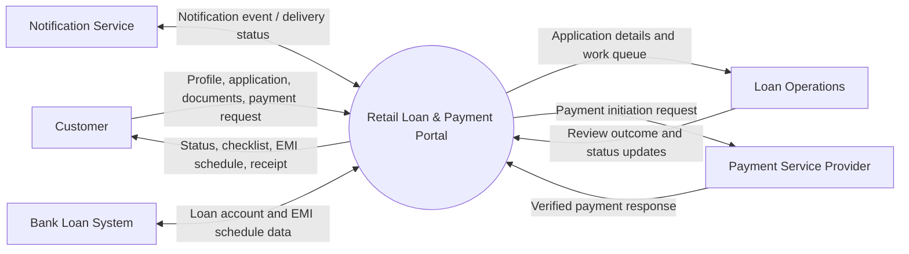

# Data Flow Diagram – Context Level

## External entities
Customer, Loan Operations, Payment Service Provider, Notification Service and Bank Loan System.

## Main system boundary
The portal coordinates customer-facing journeys. Actual credit decisions, payment settlement and authoritative loan servicing remain with bank-controlled systems and approved providers.
