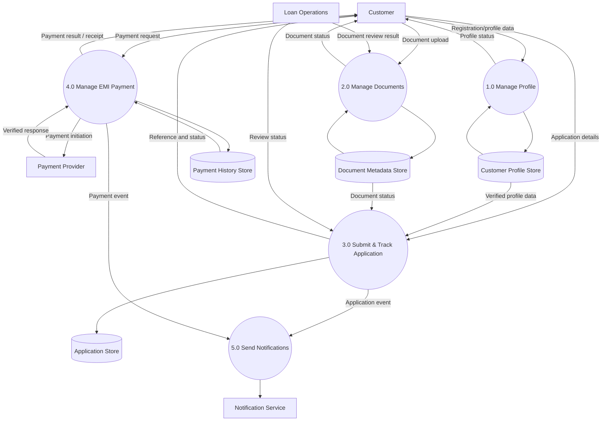

# Data Flow Diagram – Level 1

## Data stores
- D1: Customer profile
- D2: Loan application and status
- D3: Document metadata and review status
- D4: Payment transaction history

This is a conceptual DFD. A real solution would require detailed data classification, security design, integration contracts and bank architecture review.
