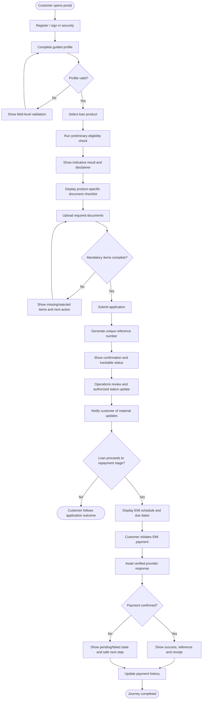

# TO-BE Workflow (Proposed Future State)

## Expected improvement
The proposed flow gives customers clearer next actions, visible application status and more transparent payment outcomes. These are intended benefits, not measured results.
